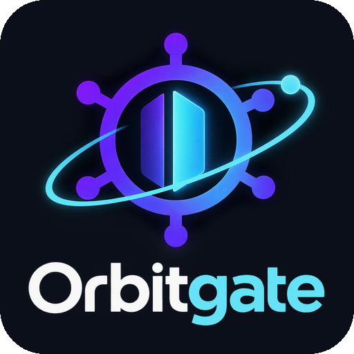

<p align="center"></p>

# Orbitgate

[](https://github.com/reflexglobal/orbitgate/releases)
[](charts/orbitgate)
[](https://artifacthub.io/packages/search?repo=orbitgate)
[](LICENSE)

Orbitgate is a small pass-through proxy in front of the kube-apiserver. It does one thing: **`kubectl get ns` only shows the namespaces you have access to.** Cluster admins see everything, and dev teams don't see each other's namespaces.

Everything else is the apiserver's job, unchanged:

- Authentication, RBAC, admission and audit all run on the apiserver. Orbitgate forwards the user's credentials untouched.
- Orbitgate never sees a decision it could get wrong, and it holds no rights beyond `list` and `watch` on namespaces.
- It runs next to the real apiserver: as normal pods (NodePort or LoadBalancer), as a DaemonSet on the control-plane nodes, optionally listening directly on their IPs, or as a [static pod](docs/static-pod.md) (e.g. on Talos) with a client certificate instead of a ServiceAccount. The apiserver itself is unchanged, and admins can keep using it directly.

```
kubectl --(user's own token)--> orbitgate --(same token, untouched)--> kube-apiserver
```

## Why Orbitgate

**The gap in Kubernetes.** RBAC decides *whether* you may list a resource, not *which items* you get back. For namespaces that leaves two bad options:

- **Grant cluster-wide `list namespaces`:** every tenant sees every other tenant's namespace names. Those names tend to leak customer names, project codenames and environments, which is a real problem in shared, regulated or defense clusters.
- **Don't grant it:** `kubectl get ns` is Forbidden. Developers can't discover their own namespaces, and tools that start from a namespace list (dashboards, IDE plugins, k9s) break or have to be fed names by hand.

**What exists already is heavy.** OpenShift projects, Rancher projects, Capsule + capsule-proxy and vcluster all solve this, but they bring a platform, CRDs or a tenancy model along. Older auth proxies like kube-oidc-proxy (archived) authenticate but don't filter.

**What Orbitgate gives you:**

| | |
|---|---|
| **Tenant separation** | Teams only see their own namespaces; cluster admins see everything. |
| **Nothing to migrate** | Works with your existing RoleBindings. No CRDs, no tenant objects, no apiserver flags or restarts. |
| **Apiserver stays the authority** | Credentials pass through untouched, so authn, RBAC, admission and audit behave exactly as on direct access. Audit logs show the real user. |
| **Tiny attack surface** | One static binary, no dependencies beyond the Go standard library, a `FROM scratch` image of ~9 MB, only `list`/`watch namespaces` RBAC, no impersonation rights. Fails closed. |
| **Airgap-friendly** | No external calls; mirror one image and one chart. TLS from your own CA, with hot reload so renewals never need a restart. |
| **Fits your topology** | Normal pods behind a NodePort/LoadBalancer, a DaemonSet on the control planes right next to the apiserver, or a static pod with its own client cert. Admins can always bypass it. |
| **Any identity provider** | Whatever the apiserver accepts (OIDC via Keycloak, Dex, Okta, Entra; ServiceAccount tokens; webhook auth). |

## How the namespace list works

For `GET /api/v1/namespaces` (list or watch):

1. Orbitgate forwards it as the user. If the apiserver allows it (e.g. cluster-admin), the real answer passes through unchanged.
2. If the apiserver says **403**, Orbitgate lists namespaces with its own identity (its ServiceAccount, or a client cert with `-client-cert`). It then asks the apiserver *as the user* (a `SelfSubjectAccessReview`) whether the user can `list pods` in each namespace.
3. Only namespaces where the answer is yes are returned. If a check errors, that namespace is hidden (fail closed). `remainingItemCount` is removed so the total count doesn't leak.

Access-review answers are cached for 30 seconds per credential and namespace, and at most 32 run at once across all users, so repeated `get ns` calls don't multiply apiserver load. A new or removed RoleBinding can therefore take up to 30 seconds to show in `get ns` (RBAC on the namespace itself applies immediately).

Watches (`kubectl get ns -w`, k9s, Lens) work the same way: a tenant's watch runs as Orbitgate's own identity, and each event is passed on only if the user may see that namespace. A tenant may not see the `DELETED` event of a namespace once its RoleBindings are gone.

Every other request (Deployments, StatefulSets, CRDs, Helm, logs, exec, port-forward) is proxied unchanged, and RBAC decides.

"Tenant of a namespace" means "can list pods there" by default, which `view`, `edit` and `admin` all grant. A custom role without pods won't show up in `get ns`, though it still works with `-n <ns>`. To use another check, set `-tenant-verb`, `-tenant-resource` and `-tenant-group` (chart: `extraArgs: [-tenant-resource=configmaps]`, or `[-tenant-group=example.com, -tenant-resource=widgets]` for a CRD).

## Audit logging

Because credentials are passed through, audit events look exactly like direct apiserver use:

| what | audit event |
|---|---|
| any request via Orbitgate | `user.username` = the real user, no `impersonatedUser`; `sourceIPs` = [client IP, Orbitgate pod IP] |
| `get ns` by a cluster-admin | one normal `list namespaces` by that user |
| `get ns` by a tenant | a `list namespaces` by the user (403), a `list namespaces` by `system:serviceaccount:<ns>:orbitgate` (or the client cert's CN), and one `create selfsubjectaccessreviews` by the user per namespace (results cached 30s per credential) |

The client IP comes from `X-Forwarded-For`, which Orbitgate sets itself (any client-sent value is replaced).

Orbitgate itself logs no requests by default; the audit log is the record. To debug network paths, `-access-log` (chart: `extraArgs: [-access-log]`) logs client IP, method, path, status and duration per request. It never logs credentials or query strings.

Add `-access-log-json` for one JSON line per request that also names the caller: `user` and `groups` (from a `SelfSubjectReview` as the caller, cached 30s per credential, so it needs Kubernetes 1.28+), plus `verb`, `apiGroup`, `namespace`, `resource`, `subresource`, `name`, `code`, `allowed` and `durationMs`. The verb and resource come from parsing the URL, for debugging; the apiserver audit log stays the authoritative record.

## Metrics and health

With `-metrics-listen=:9090` (the chart sets it from `metricsPort`), Orbitgate serves plain HTTP, unauthenticated, on a separate port:

- `/healthz`: the process is up; `/readyz`: the apiserver answers its `/readyz`.
- `/metrics` (Prometheus text format): `orbitgate_requests_total{code}`, `orbitgate_namespace_requests_total{mode="passthrough|filtered"}`, `orbitgate_ssar_total`, `orbitgate_ssar_errors_total` (a failing check hides a namespace), `orbitgate_ssar_cache_hits_total`, and `orbitgate_tls_cert_expiry_timestamp_seconds` (plus `orbitgate_client_cert_expiry_timestamp_seconds` with `-client-cert`) to alert on before a cert expires.

No namespace names, users or tokens appear in the metrics.

## Why was I rejected? (401)

The apiserver answers a bad token with a bare `Unauthorized` and puts the reason only in its own log. Orbitgate adds it: on a 401 it reads the token's claims (issuer, audience, expiry; unverified, never the token itself), logs the reason and returns it in the Status message. kubectl shows it:

```
error: You must be logged in to the server (Unauthorized: token issuer https://sso.skylab.internal/realms/airlock is not trusted; trusted: https://sso.cluster1.internal/realms/airlock)
```

The reasons, in this order:
- `no bearer token`: e.g. a client certificate (see below);
- `token issuer X is not trusted; trusted: ...`: only with `-trusted-issuers`;
- `token from issuer X expired at T`;
- otherwise the issuer and audience, so you can compare them with the apiserver's authentication config.

This is diagnostics only. The apiserver already rejected the request; Orbitgate never accepts or rejects a token itself.

Set `-trusted-issuers` to the same issuers as the apiserver's `--oidc-issuer-url` or `AuthenticationConfiguration` `jwt[].issuer.url` (chart: `extraArgs: [-trusted-issuers=https://sso.example/realms/a]`). If ServiceAccount tokens also come through Orbitgate, add the ServiceAccount issuer (`--service-account-issuer`, e.g. `https://kubernetes.default.svc.cluster.local`); otherwise a rejected ServiceAccount token is reported as "not trusted". Anyone who sends a bad token sees this list, so leave the flag off if your issuer URLs are secret; the expiry and issuer/audience reasons work without it.

### Several issuers (e.g. a fleet manager realm)

Trust lives in the apiserver, not in Orbitgate. To let a second realm in (say a fleet manager's realm next to the site's own), add a second `jwt` entry to the apiserver's `AuthenticationConfiguration` (Kubernetes 1.30+), then list both issuers in `-trusted-issuers`.

The trade-off: every trusted issuer can mint identities for this cluster. If the fleet realm is compromised, every site that trusts it is too. Limit what it can do:
- give each issuer its own username and group prefix (`claimMappings.username.prefix`, e.g. `fleet:`), so fleet users can never match a site's RoleBindings by accident;
- require an audience per cluster (`audiences`), so a token for one site does not work on the next;
- bind only the fleet groups you mean to (often read-only), and keep the fleet realm's admins few;
- prefer one issuer per cluster when you don't need central access.

## Requirements

**Cluster:** any Kubernetes with RBAC. Also needed:
- the image in a registry the cluster can pull from;
- a TLS cert for Orbitgate (see [docs/TLS.md](docs/TLS.md));
- a NodePort or LoadBalancer.

**Authentication:** users must authenticate with **bearer tokens** the apiserver accepts:
- OIDC via the apiserver's `--oidc-*` flags or `AuthenticationConfiguration`, with [kubelogin](https://github.com/int128/kubelogin) on the client side;
- ServiceAccount tokens;
- webhook token auth.

Orbitgate itself knows nothing about OIDC, so any provider the apiserver supports works (Keycloak, Dex, Okta, Entra, ...). **Client-certificate users can't go through a TLS-terminating proxy**; they keep using the apiserver directly, which is usually only break-glass admins.

**Client certificates don't work through Orbitgate.** Orbitgate terminates TLS, so a client certificate never reaches the apiserver, and the request arrives without credentials. kubectl then reports `error: You must be logged in to the server (Unauthorized: no bearer token ...)` (or `Forbidden ... system:anonymous` if anonymous auth is on). Certificate users, usually break-glass admins such as the kubeadm `admin.conf`, keep a context that points straight at the apiserver:

```sh
kubectl config set-context breakglass --cluster=<apiserver-cluster> --user=<cert-user>   # server: https://<apiserver>:6443
kubectl --context=breakglass get ns
```

**Tenants:** a namespace plus a RoleBinding granting `view`, `edit` or `admin` (or any role with `list pods`).

**Build:** Go 1.26 or Docker. **Test env:** Docker, kind, kubectl, helm, openssl, python3, and internet access to pull images.

## Install

```sh
helm install orbitgate oci://ghcr.io/reflexglobal/charts/orbitgate --version <X.Y.Z> \
  -n orbitgate --create-namespace \
  --set image.repository=<your-registry>/orbitgate \
  --set tls.certManager.enabled=true --set tls.certManager.caSecretName=<your-ca-secret> \
  --set 'tls.certManager.dnsNames={orbitgate.example.internal}'
```

Airgapped: `helm pull oci://ghcr.io/reflexglobal/charts/orbitgate --version X.Y.Z` (or take the `.tgz` from the GitHub release), and mirror `ghcr.io/reflexglobal/orbitgate:X.Y.Z` into the enclave registry.

| value | default | |
|---|---|---|
| `image.repository` / `image.tag` | `ghcr.io/reflexglobal/orbitgate` / appVersion | |
| `kind` | `Deployment` | `Deployment`: normal pods behind the Service. `DaemonSet`: one pod on every control-plane node |
| `replicas` | 2 | Deployment only |
| `hostNetwork` | false | DaemonSet only: listen directly on each control-plane node IP at `listenPort` |
| `listenPort` | 8443 | container port, or node port with `hostNetwork` (must be free on the nodes) |
| `metricsPort` | 9090 | plain-HTTP `/metrics`, `/healthz`, `/readyz` (probes use it); also a node port with `hostNetwork` |
| `daemonSet.affinity` / `.tolerations` | control-plane nodes (kubeadm, RKE2, k3s) | DaemonSet scheduling |
| `nodeSelector` / `affinity` / `tolerations` | | Deployment scheduling (`nodeSelector` applies to both) |
| `service.type` / `service.nodePort` | `NodePort` / 30443 | or `LoadBalancer`; `ClusterIP` is enough with `hostNetwork` |
| `networkPolicy.enabled` | false | ingress only on `listenPort` (from `networkPolicy.ingressFrom`, empty = anyone), egress only to the apiserver (`networkPolicy.apiserver.cidrs`/`.ports`) and DNS. No effect with `hostNetwork` |
| `tls.secretName` | `orbitgate-tls` | bring your own, or let cert-manager create it |
| `tls.certManager.enabled` | false | see [docs/TLS.md](docs/TLS.md) |
| `tls.certManager.caSecretName` | | existing CA secret in the release namespace; the chart makes an Issuer |
| `tls.certManager.issuerRef` | ClusterIssuer `orbitgate-ca` | existing (Cluster)Issuer, used when `caSecretName` is empty |
| `tls.certManager.dnsNames` / `ipAddresses` | | every name/IP users connect to |
| `extraArgs` | `[]` | e.g. `-plain-http` behind a TLS-terminating LB |
| `podDisruptionBudget.enabled` / `.minAvailable` | true / 1 | Deployment with `replicas` > 1 only |
| `topologySpreadConstraints` | `[]` | Deployment only |
| `priorityClassName` | | e.g. `system-cluster-critical` for the DaemonSet |
| `podAnnotations` / `podLabels` | `{}` | |

## Flags

The chart sets the basics; the rest goes in `extraArgs`. You need them all directly for a [static pod](docs/static-pod.md).

| flag | default | |
|---|---|---|
| `-listen` | `:8443` | |
| `-tls-cert` / `-tls-key` | | serving cert for kubectl, reloaded on change |
| `-plain-http` | false | only behind a TLS-terminating LB |
| `-apiserver` | `https://kubernetes.default.svc` | |
| `-apiserver-ca` | `<sa-dir>/ca.crt` | CA bundle that signed the apiserver cert, reloaded on change |
| `-sa-dir` | `/var/run/secrets/kubernetes.io/serviceaccount` | ServiceAccount token (own identity) and CA |
| `-client-cert` / `-client-key` | | own identity as a client cert instead of the ServiceAccount token, reloaded on change |
| `-tenant-verb` / `-tenant-resource` / `-tenant-group` | `list` / `pods` / core | the tenant check, see above |
| `-metrics-listen` | off | e.g. `:9090` for `/metrics`, `/healthz`, `/readyz` |
| `-access-log` / `-access-log-json` | false | see [Audit logging](#audit-logging) |
| `-trusted-issuers` | | comma-separated token issuers the apiserver trusts; only used to explain a 401, see [Why was I rejected?](#why-was-i-rejected-401) |
| `-version` | | print the version and exit |

Orbitgate's own identity (ServiceAccount or client cert) only ever needs `list` and `watch` on namespaces; see [docs/static-pod.md](docs/static-pod.md#what-the-identity-needs-rbac).

## User kubeconfig

Same user entry as for the apiserver; only the cluster's `server` and CA change:

```yaml
clusters:
  - name: orbitgate
    cluster:
      server: https://orbitgate.example.internal:30443
      certificate-authority-data: <base64 of the CA that signed Orbitgate's cert>
users:
  - name: oidc
    user:
      exec:
        apiVersion: client.authentication.k8s.io/v1beta1
        command: kubectl
        args: [oidc-login, get-token, --oidc-issuer-url=<issuer>, --oidc-client-id=<client>]
```

## Releases and versioning

Push a tag `vX.Y.Z` and CI tests, then publishes:
- the image `ghcr.io/reflexglobal/orbitgate:X.Y.Z` (amd64 + arm64);
- the chart `oci://ghcr.io/reflexglobal/charts/orbitgate` version `X.Y.Z` (chart version = app version);
- a GitHub release with the chart `.tgz`.

Each release also signs the image and chart with cosign (keyless) and publishes ArtifactHub metadata.

**Commits** follow [Conventional Commits](https://www.conventionalcommits.org) (`type(scope)!: subject`), and CI rejects anything else. The ArtifactHub changelog is generated from them at release time:

| commit | changelog |
|---|---|
| `feat: ...` | added |
| `fix: ...` | fixed |
| `fix(security): ...` | security |
| `perf: ...` / `refactor: ...` | changed |
| `type!: ...` | marked BREAKING |
| `docs`, `chore`, `ci`, `test`, `build`, `style` | not listed |

**Release:** `git tag vX.Y.Z && git push --tags` (pre-releases: `vX.Y.Z-alpha`, `-beta.1`, `-rc.1`; marked as pre-release on GitHub and ArtifactHub). Pick the version per [semver](https://semver.org): a `!` means a major bump (minor while on 0.x), `feat` a minor bump, `fix` a patch.

ArtifactHub (repo `orbitgate`, `oci://ghcr.io/reflexglobal/charts/orbitgate`) can only read the chart while the GHCR packages are **public**. The icon (`docs/icon.png`) shows once the GitHub repo is public too.

## Develop

```sh
go test ./...
./test/kind.sh   # own kind cluster "orbitgate" with audit logging; uses test/.kubeconfig, never ~/.kube/config
```

The e2e checks tenant isolation, admin passthrough, logs and exec through the proxy, audit identity, cert rotation from an in-cluster CA without restarts, and a static pod with a client cert from the CSR API instead of a ServiceAccount.

## Community

- [Contributing](CONTRIBUTING.md): dev setup, Conventional Commits, PR checklist
- [Code of Conduct](CODE_OF_CONDUCT.md)
- [Security policy](SECURITY.md): report vulnerabilities privately
- [Maintainers](MAINTAINERS.md)

## License

Copyright © 2026 REFLEX GLOBAL B.V. Orbitgate is free and open source software under the [MIT License](LICENSE).
